  

  
  

  

  

  

## Activity

<picture>
  <source media="(prefers-color-scheme: dark)" srcset="https://raw.githubusercontent.com/hosokaSfi/hosokaSfi/output/github-snake-dark.svg" />
  
</picture>

  

